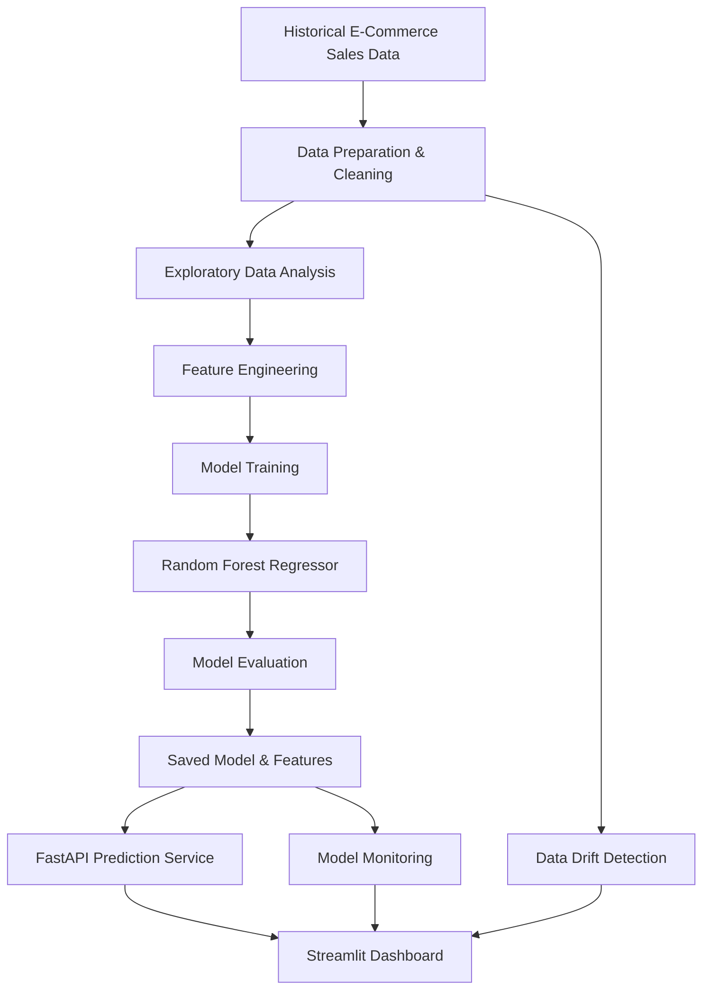

# 🛒 E-Commerce Demand Forecasting & MLOps Platform

<p align="center">
  <b>An End-to-End Machine Learning Platform for Sales Prediction, Business Intelligence & Model Monitoring</b>
</p>

<p align="center">
  
  
  
  
  
</p>

---

## 🌐 Live Demo

**Live Application:** [Deployed Application URL](https://ecommerce-mlops-r72orybhsymf2znrkpxbfn.streamlit.app/)

**GitHub Repository:** [E-Commerce MLOps](https://github.com/KrishnaGattani/ecommerce-mlops)

---

## 📌 Overview

The **E-Commerce Demand Forecasting & MLOps Platform** is an end-to-end machine learning application designed to help e-commerce businesses analyze historical sales, forecast future product demand, and monitor machine learning model performance.

The platform combines predictive analytics, interactive business intelligence dashboards, REST API integration, and model monitoring into a unified solution.

Using historical sales data, a Random Forest Regression model predicts future product demand based on temporal patterns, historical sales, and rolling averages.

The system also provides model evaluation metrics and statistical data drift detection to help identify changes in underlying sales patterns.

## ✨ Key Features

### 1. 📊 Interactive Business Intelligence Dashboard
- Overall sales performance and business KPIs.
- Total sales, product count, and store count.
- Monthly sales trend visualization.
- Interactive charts and analytical insights.

### 2. 📈 Sales Analytics
- Store-wise and product-wise sales analysis.
- Date-range based filtering.
- Historical sales trend visualization.
- Product performance comparison.
- Average and total sales calculations.

### 3. 🤖 Machine Learning Demand Forecasting
- Predicts next-day product demand.
- Uses a Random Forest Regressor.
- Generates time-based and historical sales features.
- Supports predictions using store and product IDs.
- Evaluates model performance using MAE, RMSE, and R².

### 4. 🔍 Model Performance Monitoring
- Tracks actual versus predicted sales.
- Evaluates prediction performance.
- Generates monitoring reports.
- Stores model performance results for analysis.

### 5. ⚠️ Data Drift Detection
- Uses the Kolmogorov-Smirnov (KS) statistical test.
- Compares historical and recent sales distributions.
- Detects statistically significant changes in data.
- Generates a drift detection report.

### 6. 🚀 REST API Integration
- FastAPI-powered prediction service.
- Dedicated health-check endpoint.
- Store and product information endpoints.
- Model metrics and drift report endpoints.
- JSON-based prediction requests and responses.

---

## 🛠️ Technology Stack

| Category | Technologies |
|---|---|
| Programming Language | Python |
| Data Processing | Pandas, NumPy |
| Machine Learning | Scikit-learn |
| ML Algorithm | Random Forest Regressor |
| Model Serialization | Joblib |
| Data Visualization | Plotly |
| Dashboard | Streamlit |
| Backend API | FastAPI |
| API Server | Uvicorn |
| Statistical Analysis | SciPy |
| API Communication | Requests |

---

## 🏗️ System Architecture

The platform follows a modular machine learning workflow:



## 🧠 Machine Learning Workflow

The demand forecasting pipeline consists of the following stages:

**1. Data Preparation**
- Load historical sales data.
- Convert date columns into datetime format.
- Sort records by store, product, and date.
- Handle missing feature values.

**2. Feature Engineering**

The model uses the following features:

| Feature | Description |
|---|---|
| store | Store identifier |
| item | Product identifier |
| day | Day of the month |
| month | Month of the year |
| year | Calendar year |
| day_of_week | Day of the week |
| lag_1 | Previous day's sales |
| lag_7 | Sales from 7 days ago |
| lag_28 | Sales from 28 days ago |
| rolling_7 | Previous 7-day average sales |
| rolling_28 | Previous 28-day average sales |

**3. Model Training**

A Random Forest Regressor is trained using historical sales records.

**4. Model Evaluation**

The model is evaluated using:

- **MAE:** Mean Absolute Error
- **RMSE:** Root Mean Squared Error
- **R² Score:** Coefficient of Determination

**5. Model Persistence**

The trained model and feature list are saved using Joblib for reuse during prediction.

---

## 📂 Project Structure

```text
ecommerce-mlops/
│
├── data/
│   └── cleaned_data.csv
│
├── models/
│   ├── demand_model.pkl
│   └── model_features.pkl
│
├── reports/
│   ├── model_metrics.csv
│   ├── monitoring_results.csv
│   └── drift_report.csv
│
├── api.py
├── app.py
├── app_backup.py
├── data_check.py
├── drift.py
├── eda.py
├── monitor.py
├── train_model.py
├── test_prediction.py
├── style.css
│
├── requirements.txt
└── README.md
```

---

## ⚙️ Installation & Setup

Follow these steps to run the project locally.

### Prerequisites

Make sure you have installed:

- Python 3.10 or above
- pip (Python package manager)
- Git

### Step 1: Clone the Repository

```bash
git clone https://github.com/KrishnaGattani/ecommerce-mlops.git
```

Navigate to the project directory:

```bash
cd ecommerce-mlops
```

### Step 2: Create a Virtual Environment

```bash
python -m venv venv
```

Activate the environment:

**Windows:**
```bash
venv\Scripts\activate
```

**macOS / Linux:**
```bash
source venv/bin/activate
```

### Step 3: Install Dependencies

```bash
pip install -r requirements.txt
```

### Step 4: Prepare the Dataset

Ensure the cleaned historical sales dataset is available at:

```text
data/cleaned_data.csv
```

The dataset should contain at least these columns:

- `date`
- `store`
- `item`
- `sales`

### Step 5: Train the Machine Learning Model

```bash
python train_model.py
```

This generates the trained model, feature configuration, and evaluation metrics.

### Step 6: Run Model Monitoring

```bash
python monitor.py
```

### Step 7: Run Data Drift Detection

```bash
python drift.py
```

### Step 8: Launch the Streamlit Dashboard

```bash
streamlit run app.py
```

The application will be available at:

```text
http://localhost:8501
```

### Step 9: Start the FastAPI Server

Open another terminal in the project directory and run:

```bash
uvicorn api:app --reload
```

The API will be available at:

```text
http://127.0.0.1:8000
```

Interactive API documentation:

```text
http://127.0.0.1:8000/docs
```

---

## 🔗 API Endpoints

The FastAPI service provides the following endpoints:

| Method | Endpoint | Description |
|---|---|---|
| GET | `/` | API welcome message |
| GET | `/health` | API health status |
| GET | `/stores` | Retrieve available stores |
| GET | `/items` | Retrieve available products |
| GET | `/summary` | Get sales summary |
| GET | `/metrics` | Retrieve model evaluation metrics |
| GET | `/drift` | Retrieve data drift report |
| POST | `/predict` | Generate next-day demand prediction |

### Example: Demand Prediction

**Endpoint:**

```http
POST /predict
```

**Request Body:**

```json
{
  "store_id": 1,
  "item_id": 1
}
```

**Example Response:**

```json
{
  "store_id": 1,
  "item_id": 1,
  "forecast_date": "2017-12-01",
  "predicted_sales": 24.56,
  "unit": "units"
}
```

*Note: The response above is illustrative. Actual predictions depend on the dataset and trained model.*

---

## 📉 Model Monitoring & Data Drift

Model monitoring is an important part of maintaining reliable machine learning systems.

This project includes two monitoring components:

**Model Performance Monitoring**

Compares actual and predicted sales and calculates:
- Mean Absolute Error
- Root Mean Squared Error
- R² Score

**Data Drift Detection**

Uses the Kolmogorov-Smirnov two-sample test to compare sales distributions from 2013 and 2017.

The system identifies significant distribution changes using a p-value threshold of 0.05.

- P-value less than 0.05: Drift Detected.
- P-value greater than or equal to 0.05: No Significant Drift.

---

## 🎯 Project Objectives

- Build a complete machine learning demand forecasting pipeline.
- Convert historical sales data into actionable business insights.
- Develop an interactive business intelligence dashboard.
- Deploy model predictions through a REST API.
- Implement model performance monitoring.
- Detect changes in data distributions using statistical testing.
- Demonstrate practical MLOps concepts through an integrated application.

## 🔮 Future Improvements

- Automated model retraining pipeline.
- Docker-based application deployment.
- CI/CD integration using GitHub Actions.
- Experiment tracking using MLflow.
- Model and dataset versioning using DVC.
- Advanced forecasting algorithms such as XGBoost and LightGBM.
- Automated monitoring alerts.
- Cloud-based model deployment.

## 🤝 Contributing

Contributions, suggestions, and improvements are welcome!

1. Fork the repository.
2. Create a new feature branch.
3. Commit your changes.
4. Push the branch.
5. Open a Pull Request.

## 📜 License

This project is available for educational and research purposes. Add a suitable open-source license to the repository if you intend to distribute it under specific reuse terms.

---

<p align="center">
  <b>Built with Python, Machine Learning & MLOps 🚀</b>
  <br/>
  Turning Historical Sales Data into Intelligent Business Decisions.
</p>
